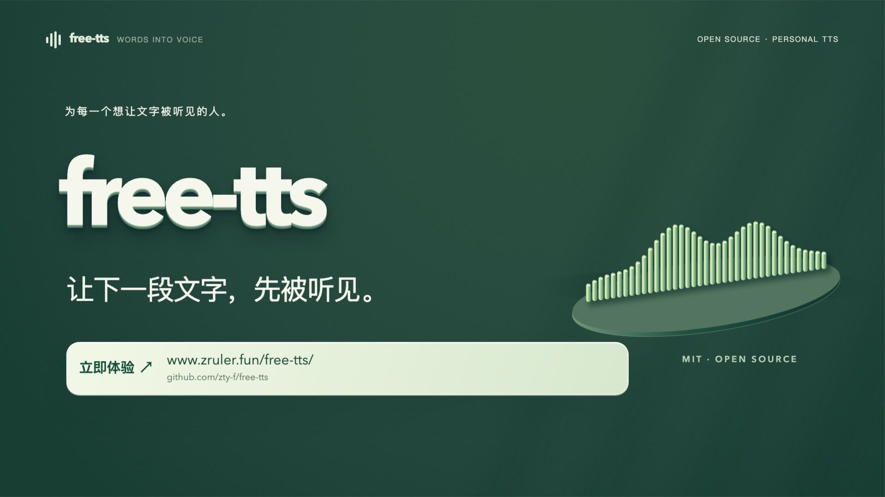
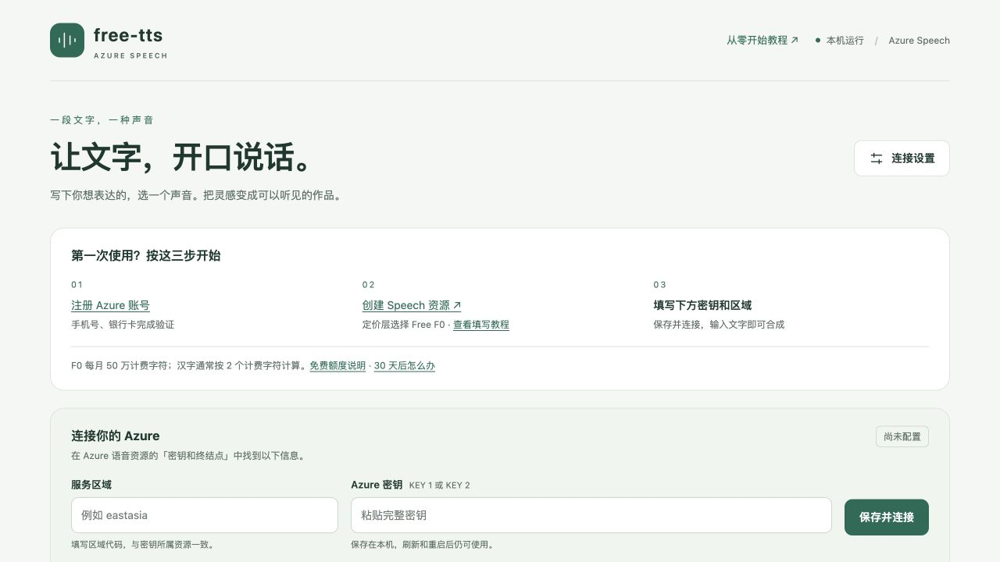

# free-tts · Free Online Text-to-Speech (TTS)

[简体中文](README.md) · **English**

**An open-source text-to-speech and voiceover web app powered by your own Azure Speech F0 resource.** Turn Chinese, English and other supported text into neural speech, adjust speaking rate and pitch, preview the result, and download an MP3. Use it directly in your browser or run the optional local app on Windows, macOS or Linux.

[Online TTS workbench](https://www.zruler.fun/free-tts/workbench/) · [Project website](https://www.zruler.fun/free-tts/) · [English guide](https://www.zruler.fun/free-tts/guide/english/) · [中文教程](https://www.zruler.fun/free-tts/guide/index/) · [Download local source ZIP](https://www.zruler.fun/free-tts/downloads/free-tts-0.2.0.zip) · [Report an issue](https://github.com/zty-f/free-tts/issues)

> MIT-licensed software. Bring your own Azure key (BYOK) and region. Free usage requires an eligible, active Azure subscription, a Speech Free F0 resource, and usage within its allowance. This is not an unlimited free API or a shared-key service. Version: v0.2.0. Azure policy checked: 2026-10-22.

The workbench interface and detailed supporting tutorials are currently in Chinese. This English README provides the complete project overview, Azure setup path, usage instructions, privacy boundaries and deployment steps. Locale codes and Azure voice identifiers remain visible in the interface.

## Watch the 61-second introduction

Meet free-tts: online text-to-speech, voice and prosody controls, MP3 downloads, Azure F0 usage and session-only key privacy. **Click the cover to watch on the project website.** The video has Chinese narration and captions.

[](https://www.zruler.fun/free-tts/#video)

[▶ Watch on the website](https://www.zruler.fun/free-tts/#video) · [Open the MP4 directly](https://www.zruler.fun/free-tts/media/free-tts-intro.mp4) · 61 seconds / 1080p

## What can I use this TTS tool for?

- **Text-to-speech:** convert articles, stories, announcements or study materials into MP3 audio.
- **Voiceover and narration:** create Chinese or English narration for personal videos, presentations and lessons.
- **Multilingual read-aloud:** choose ordinary generally available (GA) Neural voices supported in your Azure region.
- **A personal speech synthesis workbench:** use your own account and allowance instead of third-party shared endpoints.
- **Learning and self-hosting:** explore the Azure TTS REST API, direct browser requests, GitHub Pages and a dependency-free local Node.js app.

This project implements **TTS / text-to-speech: text → audio**. **Speech-to-text (STT), speech recognition and audio transcription** work in the opposite direction and are not implemented. Searching for “语音转文字” or “音频转文字” refers to transcription, not this app's speech synthesis feature.

## Online quick start

If you already have an Azure Speech resource, no download, Node.js installation or server is needed:

1. Open the [online workbench](https://www.zruler.fun/free-tts/workbench/).
2. In the [Azure portal](https://portal.azure.com/), open your Speech resource → **Keys and Endpoint**. Copy KEY 1 or KEY 2 and the region code.
3. Enter **服务区域** (region) and **Azure 密钥** (key). Use your resource's actual code, such as `eastasia`; do not enter a region display name, full URL, subscription ID or resource name.
4. Click **连接 Azure** (Connect Azure). Once connected, select a language and voice, then enter a short sentence.
5. Click **生成语音** (Generate speech), play the result, and click **下载 MP3** (Download MP3).

**The online key is kept only in the current page's memory.** The key input is cleared immediately after submission. Refreshing, leaving or closing the page clears the connection; returning through browser history does not restore it. Download audio before leaving. The application does not actively persist the online text or audio.

Every online generation sends a new request to Azure. There is no automatic retry or deduplication cache. Playing or downloading an existing result does not synthesize it again.

## Set up Azure Speech Free F0

### 1. Register and activate a subscription

Open [Azure's free account page](https://azure.microsoft.com/free/) and follow Microsoft's account, phone and payment verification flow. Eligibility varies; registration may require a supported bank card and a small temporary authorization. Never share card numbers, CVV codes, verification codes or Azure keys in issues.

After registration, open **Subscriptions** in the [portal](https://portal.azure.com/) and confirm your subscription is active. Already have a valid subscription? You do not need to register again.

### 2. Create a Speech resource

Open [Create Azure Speech](https://portal.azure.com/#create/Microsoft.CognitiveServicesSpeechServices). If the link opens only the portal homepage, use **Create a resource → Marketplace → search Speech → Microsoft → Create**.

| Field | What to select |
| --- | --- |
| Subscription | Your active Azure subscription |
| Resource group | Create a group, such as `free-tts-rg`, or choose an existing one |
| Region | An available region; keep its code for the workbench |
| Name | A valid, available name such as `my-free-tts-001` |
| Pricing tier | **Free F0**, also checked on the final review screen |

Review any terms or notices yourself, then use **Review + create → Create → Go to resource**. The project needs a Speech resource, not a virtual machine, database or GPU. If F0 is unavailable, check the resource type, subscription and existing free resources before proceeding; do not assume S0 has the same free allowance.

### 3. Copy the matching key and region

Under the resource's **Keys and Endpoint**, copy KEY 1 or KEY 2 and its region code. Enter both in the online workbench. Confirm F0 separately in Azure: a successful voice-list request or synthesis proves connectivity, not your pricing tier.

Supporting walkthroughs in Chinese: [Registration](docs/azure-registration.md) · [Speech F0 setup](docs/azure-f0-setup.md) · [Online usage](docs/online-workbench.md).

## Free allowance and billing

- The app is free and open source. Azure service usage belongs to your own subscription.
- Azure Speech **Free F0** currently includes **500,000 billable characters per month**. Unused allowance does not roll over.
- Each Chinese character counts as **two billable characters**; roughly 250,000 Chinese characters would use that allowance before punctuation, whitespace and applicable SSML overhead.
- The online and local apps share usage when they use the same Azure resource.
- The eligible new-account **$200 credit is a 30-day trial benefit**, not a monthly grant.
- Continuing after the trial generally requires upgrading the subscription while keeping the Speech resource on F0. Subscription upgrades and changing the resource to S0 are separate actions.
- **S0 is pay-as-you-go; do not assume its first 500,000 characters are free.** This app does not upgrade resources automatically.

Always check the [official Azure Speech pricing](https://azure.microsoft.com/en-us/pricing/details/speech/) and [billable character definition](https://learn.microsoft.com/en-us/azure/ai-services/speech-service/text-to-speech#billable-characters). Full policy notes in Chinese: [Free allowance](docs/free-quota.md) · [After the trial](docs/subscription.md).

## Features and online vs. local usage

| Feature | Online workbench | Local app |
| --- | --- | --- |
| Chinese, English and other ordinary GA Neural voices | Loaded from your Azure region | Loaded from your Azure region |
| Speaking rate and pitch | 0.5×–2× rate, -20%–+20% pitch | Same controls |
| Preview and MP3 download | Supported | Supported |
| Character and duration estimates | Text-only estimates, not remaining quota | Same estimates |
| Key storage | Current page's memory only | Local `.local/config.json` |
| Audio history | Current result; download manually | Most recent 20 cached clips |
| Repeated identical generation | New Azure request each time | Can reuse matching cached audio |
| Requirements | Modern browser | Node.js 22+ and curl |
| Connection | Browser → Azure | Local Node service → curl → Azure |

Each request is limited to **3,000 Unicode input characters**. A conservative estimate above **8 minutes** asks you to split the text before approaching Azure's 10-minute real-time audio limit. Estimates are not a quota meter. Voice cloning, audio transcription, subtitle timing and automatic long-form merging are not included.



## Optional local installation

Install [Node.js 22+; 24 LTS recommended](https://nodejs.org/en/download) and [curl](https://curl.se/download.html). There are no third-party npm runtime dependencies, so **npm install is not required**.

Download and fully extract the [source ZIP](https://www.zruler.fun/free-tts/downloads/free-tts-0.2.0.zip), or clone the repository:

```sh
git clone https://github.com/zty-f/free-tts.git
cd free-tts
npm run doctor
npm start
```

- **macOS:** double-click `启动free-tts.command`, or run `sh start.sh`.
- **Windows 10/11:** fully extract the ZIP, then double-click `启动free-tts.bat`.
- **Linux:** run `sh start.sh` from the project directory.
- **PowerShell restrictions:** use `node scripts/start.mjs --doctor` and `node scripts/start.mjs --open` instead of changing execution policy.

Open [http://127.0.0.1:4318](http://127.0.0.1:4318). Keep the terminal running; Ctrl+C stops the service. To use another port on macOS/Linux, run `PORT=4319 npm start`. In PowerShell, set `$env:PORT='4319'` before starting the app. Details in Chinese: [Cross-platform local setup](docs/local-setup.md).

## Keys, privacy and data flow

**Online:** browser → your Azure Speech resource → browser audio player and download.

The key is sent to Azure in an HTTPS request header, never placed in the URL or sent through a project relay backend. The app does not actively write it to localStorage, sessionStorage, cookies or normal logs. There is no remember-key option, account sync, telemetry or third-party runtime script. **断开并清除密钥** disconnects and clears the page's key; **取消并断开** cancels the request and disconnects. Azure may still count text processed before cancellation.

The page's JavaScript needs to read your key. Use a trusted project website or a version you host yourself. Browser extensions, malicious same-origin scripts or a compromised device could still access page data; keeping a key in memory is not encryption. Your browser's own password-manager behavior is outside the app's control.

**Local:** browser → local Node service → Azure Speech → local audio cache and download.

The local key is stored as plaintext in ignored `.local/config.json`; audio and metadata without the full input text are stored in `.local/audio/`. Unix directories use mode 700 and files 600; Windows relies on account directory permissions. The service binds to 127.0.0.1 only. Local drafts use browser storage on the local site.

Never share `.local/`, `.env`, private audio or screenshots containing secrets. Rotate leaked keys in Azure. See [SECURITY.md](SECURITY.md) for the full policy, currently in Chinese.

## Deploy your own GitHub Pages site

1. Fork [zty-f/free-tts](https://github.com/zty-f/free-tts).
2. In **Settings → Pages**, select **GitHub Actions** as the source and enable repository workflows.
3. A push to `main` runs tests, builds the static website and deploys it to Pages.
4. Visitors enter their own key in their browser. **Do not put Azure keys in GitHub Secrets, source files or the build output.**

The default repository name is `free-tts` and the base path is `/free-tts/`. If you rename it, set `SITE_BASE_PATH` on the workflow's build step, for example `/my-tts/`; use `/` for a standalone domain root. Set `SITE_ORIGIN` to your site's HTTPS origin for canonical URLs and the sitemap, and update project-specific absolute links as needed.

```sh
npm run build:site
```

The build writes ignored `_site/`. GitHub Pages hosts static files; Azure synthesizes the speech. There is no public Node synthesis backend. The English guide and Chinese project overview share reciprocal language links.

## FAQ

### Is this free TTS or speech-to-text?

It is **text-to-speech / speech synthesis**: written text becomes audio. **Speech-to-text / STT / 语音转文字** transcribes audio into text and is not implemented here.

### Can I use it without an Azure account?

No. This is a bring-your-own-key tool. You need a valid subscription, Speech resource, key and region. No shared keys or unlimited free endpoints are provided.

### Does it support both Chinese TTS and English TTS?

Yes, subject to the ordinary GA Neural voices returned for your region. Other supported languages appear in the same list.

### Why did my key and audio disappear after refreshing?

The online workbench intentionally keeps them in the current page's memory only. Download audio before leaving. The optional local app can retain its configuration and recent audio history.

### Does the character counter show my remaining Azure allowance?

No. It estimates billable text characters and does not query live monthly allowance. Confirm pricing tier, usage and subscription status in Azure.

### Can I synthesize speech fully offline?

No. Both modes use Azure's cloud service and require network access. The local app runs its interface and server on your computer.

Troubleshooting in Chinese: [Common errors](docs/troubleshooting.md) · [Official links](docs/links.md).

## Development and contributions

```sh
npm test
npm run check
npm run package
```

Automated tests mock Azure and need no real key. CI covers Windows, macOS, Linux and Node.js 22/24. Actual browser and cloud verification scope is recorded in [verification notes](docs/verification.md), currently in Chinese.

Packaging collects allowlisted source files into `.local/releases/free-tts-0.2.0.zip`, excluding local configuration, cached audio and environment files. Do not zip the whole working directory to share it.

[Contributing](CONTRIBUTING.md) · [Security](SECURITY.md) · [Changelog](CHANGELOG.md) · [Issues](https://github.com/zty-f/free-tts/issues) · [MIT license](https://github.com/zty-f/free-tts/blob/main/LICENSE)

This project is not affiliated with Microsoft. The MIT license covers this project's code; Azure service terms, voice terms and generated-content obligations apply separately.
